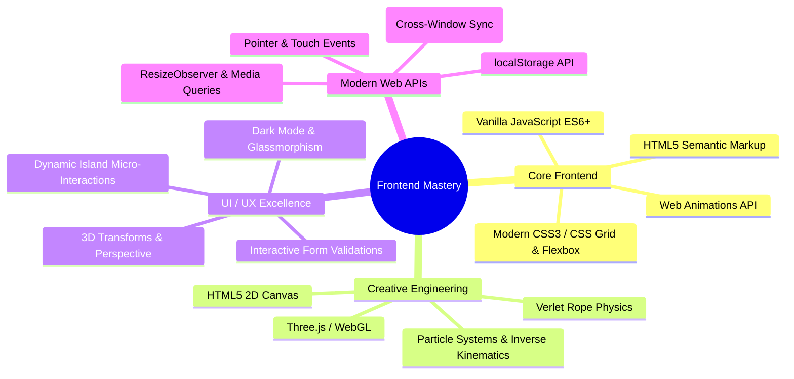

# 🌟 Frontend Mastery 🚀

<div align="center">


[](https://developer.mozilla.org/en-US/docs/Web/HTML)
[](https://developer.mozilla.org/en-US/docs/Web/CSS)
[](https://developer.mozilla.org/en-US/docs/Web/JavaScript)
[](https://threejs.org/)
[](https://greensock.com/gsap/)
[](https://www.khronos.org/webgl/)
[](LICENSE)

<p align="center">
  <b>A curated showcase of next-generation frontend engineering, creative web animations, tactile UI micro-interactions, responsive web applications, and interactive WebGL / Canvas physics experiments.</b>
</p>

[Explore Projects](#-project-directory) • [Key Features](#-core-categories) • [Tech Stack](#-technologies--skills-demonstrated) • [Getting Started](#-getting-started--how-to-run) • [Connect](#-author--connect)

</div>

---

## 📖 Overview

**Frontend Mastery** represents a comprehensive journey through modern web development—ranging from production-ready e-commerce platforms and clean utility applications to cutting-edge visual experiments utilizing **HTML5 Canvas**, **Three.js**, **Verlet rope physics**, **Apple-inspired UI mechanics**, and **3D CSS perspective transforms**.

Each project is self-contained, modular, and built to demonstrate clean code, semantic structure, responsive layouts, and captivating user experiences.

---

## 🎯 Core Categories

```
Frontend Mastery
├── 🛒 Full-Scale Web Applications (Multi-page E-Commerce, LocalStorage Apps)
├── 🔮 Next-Gen Creative UI & Micro-Interactions (Holographic Card, Firefly Login, Dynamic Island)
├── ⚡ Canvas, Three.js & Physics Engines (Verlet Rope, Lightning Canvas, 3D WebGL, Multi-window Sync)
├── 💼 Developer Portfolios & Landing Pages (Glassmorphic, AOS-powered, Custom Themes)
└── 📸 Interactive Galleries & Utility Components (Polaroid Drag-and-Drop, Digital Clocks, Sliding Auth)
```

---

## 🗂️ Project Directory

| # | Project / Module | Category | Primary Stack | Key Highlights | Direct Link |
|---|---|---|---|---|---|
| 01 | **Pabitra E-Commerce** | Full E-Commerce Platform | HTML5, CSS3, JS, Responsive Grid | Complete 9-page responsive store: Shop, Product Details, Cart, Checkout, Wishlist, Compare, Auth, Account Dashboard | [Pabitra-ecommerce/](Pabitra-ecommerce/) |
| 02 | **Holo Card Checkout** | 3D Micro-Interaction | CSS 3D (`preserve-3d`), Pointer Events, JS | Holographic foil shine, cursor-following 3D tilt, flip animation on CVV focus, card brand auto-detection (Visa/MC), live formatting | [holo_card.html](holo_card.html) |
| 03 | **Firefly Spark Login** | Creative UI / Canvas | HTML5 Canvas, Pointer Tracking, CSS | Animated firefly light bug carrying an ambient dark-mode spotlight, illuminates fields, dives into password input, auto-demo loop | [spark_login.html](spark_login.html) |
| 04 | **Pull Cord Lamp** | Real-Time Physics / Canvas | Verlet Physics, HTML5 Canvas, CSS | 60 FPS Verlet rope integration, interactive pull-cord bead, incandescent filament glow heat simulation, dynamic text shadow cast | [pull_lamp.html](pull_lamp.html) |
| 05 | **Neon Password Strength** | Tactile UI / Micro-Interaction | CSS Neon Shaders, JS Entropy Engine | Multi-segment glowing gas-discharge tube that ignites by password strength; sputters and shoots particle sparks on weak submission | [neon_password.html](neon_password.html) |
| 06 | **OTP Dynamic Island** | Apple-Inspired UI | CSS Transitions, Web Animations API | iOS-style dynamic island morphing pill; OTP chips fly into cells along parabolic bezier trajectories; auto-merge verification | [otp_island.html](otp_island.html) |
| 07 | **Tentacle Sync Cursor** | Cross-Window Canvas | HTML5 Canvas, `BroadcastChannel` API | Inverse-kinematics red tentacle cursor following pointer; synchronizes across multiple browser tabs/windows in real time | [-TENTACLE-SYNC-CURSOR-main/](-TENTACLE-SYNC-CURSOR-main/) |
| 08 | **Crystal Heart 3D** | 3D WebGL Experience | Three.js (r135), GSAP, GLTFLoader | Real-time 3D crystal heart mesh with orbiting particles, customized vertex shaders, dynamic camera choreographies | [Heart_song/](Heart_song/) |
| 09 | **Thunder to Text** | Generative Canvas FX | HTML5 2D Canvas, Particle Math | Converts custom typed text into particle coordinates with procedural electrical discharge arcs and lightning strikes | [Thunder/](Thunder/) |
| 10 | **Particle Network** | Interactive Canvas | HTML5 Canvas, Distance Math | Dynamic constellation particles connected by proximity distance lines with interactive magnetic mouse repulsion radius | [animation/](animation/) |
| 11 | **Creative Developer Portfolio** | Portfolio Experience | Modern CSS, Cursor Glow, Flex/Grid | Sleek dark-mode developer portfolio featuring ambient cursor glow, smooth navigation, project cards, and mobile menu | [Portfolio/](Portfolio/) |
| 12 | **Pabitra Portfolio (AOS)** | Responsive Portfolio | AOS (Animate on Scroll), FontAwesome | Animated portfolio featuring entrance animations, skills showcase, responsive drawer menu, and social links | [myPage3/](myPage3/) |
| 13 | **Babu Portfolio** | Personal Portfolio | CSS Responsive Design, Hamburg Menu | Clean responsive personal website with mobile modal navigation, service cards, and skills overview | [Mypage2/](Mypage2/) |
| 14 | **PL Web Designer** | Landing Page | Modern CSS, Neon Accents, Ionicons | Bold typography personal brand site showcasing frontend services, hire me CTA, and social integrations | [PL/](PL/) |
| 15 | **To-Do List App** | Productivity Web App | JavaScript DOM, `localStorage` | Fast task tracker with complete/delete states, persistent storage across browser reloads, and clean mobile UI | [ToDo_List/](ToDo_List/) |
| 16 | **Draggable Polaroid Wall** | Interactive Gallery | Touch Events, Pointer Dragging, CSS | Interactive draggable photos with randomized angles, pinned notes, iframe video integration, and mobile touch support | [wpPic/](wpPic/) |
| 17 | **Cyberpunk Orbitron Clock** | UI Utility | Orbitron Typography, CSS Gradients | High-contrast digital clock UI displaying live system hours, minutes, seconds, and date inside a glassmorphic card | [clock.html](clock.html) |
| 18 | **ECG Heartbeat Pulse** | SVG Animation | SVG Paths, `stroke-dashoffset` Keyframes | Electrocardiogram monitor waveform with animated dashoffset synchronized to a pulsing anatomical heart shape | [Heartbeat/](Heartbeat/) |
| 19 | **Floating Hearts Stream** | DOM Particle Engine | CSS Keyframes, Dynamic Element Creation | Continuous generator of randomized pastel-to-ruby floating hearts with variable drift, sizes, and automated DOM garbage collection | [Floatheart/](Floatheart/) |
| 20 | **Coding Club Sliding Auth** | Interactive Form | Pure CSS Radio Tabs, Flexbox | Dual Login & Registration modal featuring a smooth sliding pill indicator (`.slider-tab`) with zero external dependencies | [LoginForm/](LoginForm/) |
| 21 | **Classic Webpage Portfolio** | Showcase Page | Semantic HTML, CSS Layouts | Clean introductory personal portfolio with shape framing, CV download trigger, and responsive navigation header | [Webpage/](Webpage/) |

---

## 🚀 Detailed Project Highlights

### 1. 🛒 Pabitra E-Commerce Store
A complete, multi-page, production-ready frontend template for a modern e-commerce storefront:
- **9 Dedicated Pages:** Home (`index.html`), Shop (`shop.html`), Product Details (`details.html`), Cart (`cart.html`), Checkout (`checkout.html`), Wishlist (`wishlist.html`), Compare (`compare.html`), Login/Register (`login-register.html`), and Customer Dashboard (`accounts.html`).
- **Rich Features:** Category carousels, flash deals with countdown timers, dynamic product cards with badges, star ratings, tabbed product information, quantity selectors, checkout summaries, and newsletter forms.
- **Responsive Architecture:** Modular stylesheet and asset structure located in `Pabitra-ecommerce/assets/`.

### 2. 💳 Holo Card 3D Tilt & Flip Checkout
A credit card payment UI inspired by modern fintech applications:
- **Realistic 3D Tilt:** Uses CSS `perspective: 1000px` and custom properties (`--rx`, `--ry`, `--sx`, `--sy`) mapped to pointer coordinates.
- **Double-Sided 3D Card Flip:** When focusing the CVV input field, the card smoothly rotates 180 degrees along the Y-axis (`transform-style: preserve-3d`).
- **Live Form Sync:** Card brand detection (Visa vs. Mastercard regex), dynamic card number grouping into 4-digit blocks with bullet placeholders, uppercase cardholder name, and MM/YY expiry auto-formatting.

### 3. 💡 Pull-Cord Lamp with Verlet Physics
An interactive physics experiment merging HTML5 Canvas with DOM elements:
- **Verlet Rope Integration:** Solves particle constraints at a locked 60 FPS physics tick, delivering lifelike pendulum inertia, swing friction, and tension feedback.
- **Thermal Filament Glow:** Calculates filament temperature over time (`heat()`) to simulate an authentic incandescent warm-up curve with bloom gradients and anamorphic lens streaks.
- **Dynamic Cast Shadow:** The bulb's live coordinate position continuously computes and projects soft directional text-shadows on the page headline.

### 4. 🪪 Neon Gas-Discharge Tube Password Strength
A tactile password input component simulating real physical neon gas:
- **Entropy Evaluation:** Scores passwords based on length, mixed casing, digits, and special characters.
- **Multi-State Lighting:** Progressive neon segments ignite with intense radial glows (`--glow`, `--light`).
- **Sputter & Failure Physics:** Submitting a weak password causes the neon tube to flicker ("sputter"), shakes the card, and spawns randomized CSS/JS sparks that fly outward under simulated gravity.

### 5. 🏝️ Dynamic Island 6-Digit OTP Input
An Apple-inspired authentication micro-interaction:
- **Morphing Island:** Transitions between compact pill, expanded notification, and completed status.
- **Parabolic Particle Flight:** Tapping the suggested SMS code chip causes each digit to detach and fly along an interpolated bezier curve directly into its respective input cell.
- **Cell Merging:** Upon entering the full code, input cells merge seamlessly into a unified pill with a green verification indicator.

### 6. 🐙 Tentacle Sync (BroadcastChannel Red Anime Cursor)
A multi-window generative artwork experiment:
- **Inverse Kinematics:** Procedural bone-chain mathematics render flowing tentacles that follow the user's cursor across the canvas.
- **Cross-Window Synchronization:** Leverages the native browser `BroadcastChannel` API to synchronize cursor coordinates and animation states across multiple browser windows or tabs simultaneously!

### 7. 💎 Crystal 3D Heart (Three.js & GSAP)
A high-performance WebGL scene:
- Built with **Three.js** and **GSAP** for smooth easing and timeline management.
- Features a GLTF low-poly 3D crystal heart mesh surrounded by thousands of orbiting floating light particles, custom lighting, and reflective material properties.

---

## 🛠️ Technologies & Skills Demonstrated



---

## 📁 Repository Structure

```
Frontend--mastery/
├── index.html                         # 🌟 Master Showcase Portal & Interactive Launchpad
├── vercel.json                        # 🚀 Vercel routing config & clean URL rewrites
├── .gitignore                         # Git ignore rules for OS and IDE files
├── README.md                          # Repository documentation & guide
├── LICENSE                            # MIT Open Source License
│
├── 🛒 Full-Featured Applications
│   ├── Pabitra-ecommerce/             # 9-page responsive e-commerce platform
│   │   ├── index.html                 # Storefront homepage
│   │   ├── shop.html                  # Product catalog
│   │   ├── details.html               # Product detail & specs
│   │   ├── cart.html                  # Shopping cart
│   │   ├── checkout.html              # Checkout & payment forms
│   │   ├── wishlist.html              # Customer wishlist
│   │   ├── compare.html               # Product comparison
│   │   ├── login-register.html        # Authentication page
│   │   ├── accounts.html              # User profile & orders
│   │   └── assets/                    # Stylesheets, scripts, images & fonts
│   └── ToDo_List/                     # LocalStorage task manager web app
│       ├── index.html
│       ├── style.css
│       └── script.js
│
├── 🔮 Interactive UI Components & Micro-Interactions
│   ├── holo_card.html                 # 3D holographic tilt & flip checkout card
│   ├── spark_login.html               # Firefly spotlight particle login form
│   ├── pull_lamp.html                 # Verlet physics pull-cord lamp & bloom
│   ├── neon_password.html             # Glowing neon tube password strength meter
│   ├── otp_island.html                # iOS Dynamic Island 6-digit OTP verification
│   ├── LoginForm/                     # Coding Club dual sliding auth tabs
│   │   ├── loginform.html
│   │   └── loginform.css
│   └── clock.html                     # Futuristic Cyberpunk Orbitron digital clock
│
├── ⚡ Canvas, 3D & Particle Experiments
│   ├── -TENTACLE-SYNC-CURSOR-main/    # Multi-window BroadcastChannel tentacle canvas
│   │   ├── index.html
│   │   ├── style.css
│   │   └── script.js
│   ├── Heart_song/                    # Three.js & GSAP 3D crystal heart animation
│   │   ├── index.html
│   │   ├── style.css
│   │   └── script.js
│   ├── Thunder/                       # Thunder-to-text procedural lightning generator
│   │   ├── thunder.html
│   │   ├── thunder.css
│   │   └── thunder.js
│   ├── animation/                     # Particle network constellation background
│   │   ├── abc1.html
│   │   ├── abc1.css
│   │   └── abc1.js
│   ├── Heartbeat/                     # SVG electrocardiogram line & pulsing heart
│   │   ├── heartbeat.html
│   │   └── heartbeat.css
│   └── Floatheart/                    # Continuous floating heart particle stream
│       ├── floatheart.html
│       ├── floatheart.css
│       └── script.js
│
├── 💼 Developer Portfolios & Landing Pages
│   ├── Portfolio/                     # Modern Creative Developer dark portfolio
│   │   ├── index.html
│   │   ├── style.css
│   │   └── script.js
│   ├── myPage3/                       # Pabitra Lenka portfolio with AOS animations
│   │   ├── mypage3.html
│   │   ├── mypage3.css
│   │   └── mypage3.js
│   ├── Mypage2/                       # Babu / Pabitra responsive portfolio
│   │   ├── mypage2.html
│   │   └── mypage2.css
│   ├── PL/                            # Personal Web Designer portfolio
│   │   ├── pl.html
│   │   └── pl.css
│   └── Webpage/                       # Portfolio showcase landing page
│       ├── webpage.html
│       └── webpage.css
│
└── 📸 Galleries & Media
    └── wpPic/                         # Draggable Polaroid photo wall with touch events
        ├── wppic.html
        ├── wppic.css
        └── wppic.js
```

---

## 🚀 Deploying to Vercel (All Projects in One Link)

Yes! All 21 projects can be showcased and run from **one single Vercel link**:

### How It Works:
1. **Master Launchpad (`index.html`):**
   - When visitors land on your root Vercel domain (`https://frontend-mastery.vercel.app/`), they are greeted by an interactive **Showcase Portal**.
   - Visitors can search, filter by category (Full Apps, 3D, Micro-Interactions, Canvas, Portfolios), and launch an **In-Page Live Modal Preview** with mobile/tablet/desktop device toggles!
2. **Dedicated Project Routes:**
   - Every project is also accessible directly via clean routes defined in [`vercel.json`](vercel.json):
     - `https://your-domain.vercel.app/ecommerce` → Pabitra E-Commerce Store
     - `https://your-domain.vercel.app/holo-card` → 3D Holographic Card
     - `https://your-domain.vercel.app/spark-login` → Firefly Spark Login
     - `https://your-domain.vercel.app/lamp` → Pull Cord Lamp Physics
     - `https://your-domain.vercel.app/neon-password` → Neon Password Strength
     - `https://your-domain.vercel.app/otp` → OTP Dynamic Island
     - `https://your-domain.vercel.app/portfolio` → Creative Developer Portfolio
     - `https://your-domain.vercel.app/todo` → To-Do List Web App
     - `https://your-domain.vercel.app/heart-3d` → Three.js Crystal Heart 3D
     - `https://your-domain.vercel.app/thunder` → Thunder to Text Generator
     - `https://your-domain.vercel.app/tentacles` → Tentacle Sync Canvas
     - *(and all other components at their clean URLs)*

### Deploying via Vercel (Option 1: One-Click Git Import - Recommended):
1. Go to [vercel.com/new](https://vercel.com/new).
2. Connect your GitHub account and click **Import** next to `Frontend--mastery`.
3. Keep default settings (Framework Preset: **Other**, Root Directory: `./`).
4. Click **Deploy**! In ~15 seconds, your master showcase will be live.

### Deploying via Vercel CLI (Option 2):
```bash
npx vercel
```
Follow the terminal prompts to link and deploy your project.

---

## 💻 Getting Started & How to Run Locally

### 1. Clone the Repository
```bash
git clone https://github.com/pabitralenka07/Frontend--mastery.git
cd Frontend--mastery
```

### 2. Run Any Project

All projects are built with zero build step dependencies required—pure Vanilla HTML5, CSS3, and JavaScript!

#### Option A: Direct in Browser
Simply double-click `index.html` (or any sub-project HTML file) to open directly in your browser.

#### Option B: VS Code Live Server (Recommended)
1. Install the **Live Server** extension in VS Code.
2. Right-click on any `.html` file (e.g., `holo_card.html` or `Pabitra-ecommerce/index.html`).
3. Click **"Open with Live Server"**.

#### Option C: Local HTTP Server
Using Python:
```bash
# Python 3
python3 -m http.server 8000
```
Then navigate to `http://localhost:8000/` in your browser.

Using Node.js:
```bash
npx serve .
```

---

## 💡 Key Design & Engineering Concepts

1. **Hardware-Accelerated 3D Transforms:**
   - Leveraging `transform: translate3d()`, `perspective()`, and `backface-visibility: hidden` ensures smooth 60 FPS transitions rendered on the GPU without triggering layout reflows.
2. **Procedural Particle Mathematics:**
   - Calculations for distance vectors, inverse kinematics, trigonometric wave oscillations, and collision boundaries implemented directly in vanilla JS.
3. **Verlet Integration:**
   - Unlike standard Euler integration, Verlet integration preserves stable rope constraints and accurate damping curves for real-time physics.
4. **Resilient Local State:**
   - Clean implementation of `localStorage` state serialization and deserialization patterns for offline persistence.
5. **Cross-Tab Web Messaging:**
   - Utilization of `new BroadcastChannel('channel_name')` enables synchronization of state and animations across independent browser tabs without server-side WebSockets.

---

## 👤 Author & Connect

<div align="center">

### **Pabitra Lenka**
*Web Designer & Frontend Developer from Odisha, India*

[](https://github.com/pabitralenka07)
[](https://www.linkedin.com/in/pabitra-lenka-777423324/)
[](https://x.com/PabitraLenka777)
[](https://www.instagram.com/_duh._.its_babu_?igsh=MXZyODBoenlvOHZ1dQ==)

---

⭐ **If you find this repository inspiring or helpful, please consider starring it on GitHub!** ⭐

</div>

---

## 📄 License

This repository is open-sourced under the [MIT License](LICENSE). Feel free to use, modify, and build upon these components for personal and educational projects.
